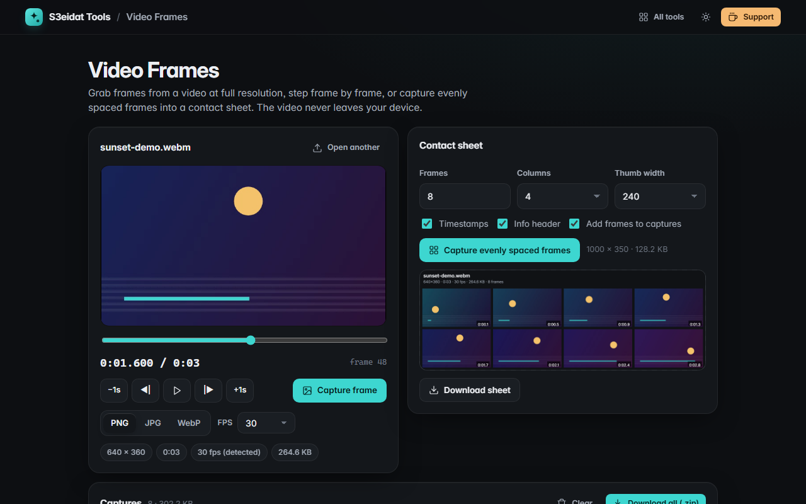

# Video Frames

> Grab frames, thumbnails and contact sheets from a video. Free, private, and it runs entirely in your browser.

### ▶ [Open Video Frames](https://s3eidat.github.io/video-frames/)



## Features

- Open or drop **MP4, WebM, MOV, MKV**: anything your browser can play
- **Scrub**, play/pause, **step one frame** back or forward, jump ±1 second; frame rate **auto-detected** (or pick it)
- **Capture the current frame** at the video's **native resolution** as **PNG, JPG or WebP** (quality slider)
- **Auto-capture N evenly spaced frames** (2–60) into a **contact sheet** with timestamps and an info header,
  choose columns and thumbnail width
- Captures gallery: click to jump back to that moment, download one, or **download all as a ZIP** (contact sheet included)
- Keyboard: <kbd>←</kbd>/<kbd>→</kbd> frame step, <kbd>Shift</kbd>+arrows ±1 s, <kbd>Space</kbd> play/pause, <kbd>C</kbd> capture

## Privacy

Your video never leaves your device. There is no server, no account, no analytics. The page ships with a
strict Content-Security-Policy (`connect-src 'self'`), so the browser itself blocks any attempt to send data anywhere.

## Run it yourself

It's plain HTML, CSS and JavaScript with no build step:

```bash
git clone https://github.com/s3eidat/video-frames
cd video-frames
python -m http.server 8000
```

Then open http://localhost:8000.

## Support

If this saved you time, **[buy me a coffee ☕](https://s3eidat.github.io/coffee/)**. It keeps every tool free.

---

Part of **[S3eidat Tools](https://s3eidat.github.io/)**: 100+ free, private tools that run in your browser. MIT licensed.
